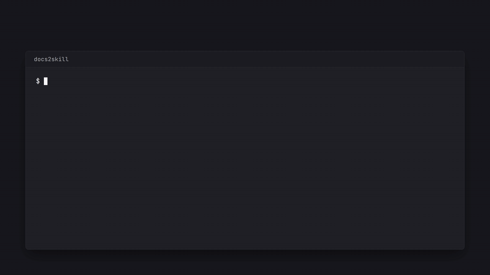

# docs2skill: turn any docs site into an agent skill, llms.txt and llms-full.txt

[](https://github.com/OfficialSpicrawl/docs2skill/actions/workflows/test.yml)
[Live demo](https://docs2skill.spicrawl.com) · [Demo video (MP4)](videos/out/docs2skill/v1/docs2skill.mp4) · Apache-2.0



Give your **AI agents** and **coding agents** (Claude Code, Codex, Cursor) the docs they need: docs2skill turns any documentation site into a **Claude Code / Codex agent skill**, **llms.txt** and **AGENTS.md** in one command, ready for **RAG** and LLM context. It also ships as an agent skill itself ([`SKILL.md`](SKILL.md)).

**Install as an agent skill** (Claude Code, Codex, Cursor and more): `npx skills add OfficialSpicrawl/docs2skill`, then run `npm install` in the installed folder. Or clone it and run it yourself:

Point it at a docs site and get an [agent skill](#turn-docs-into-an-agent-skill) (`SKILL.md`), an `AGENTS.md`, [`llms.txt`](https://llmstxt.org) and `llms-full.txt`, built on the [Spicrawl](https://spicrawl.com) web scraping API. Try it on up to 5 pages in the browser at [docs2skill.spicrawl.com](https://docs2skill.spicrawl.com) (see [`demo/`](demo)), or run the CLI on the whole site.

- `llms.txt` is the index: a title, a one-line summary, and a link plus short description for each page, grouped into sections.
- `llms-full.txt` is every page's content as markdown in one file, ready to paste into an LLM context window.
- With `--skill <name>` it also writes an [agent skill](#turn-docs-into-an-agent-skill) and an `AGENTS.md` from the same pages.

The CLI is one file, [`llms-txt.mjs`](llms-txt.mjs). Node 18+, plain JavaScript, no build step, one dependency ([`@spicrawl/sdk`](https://www.npmjs.com/package/@spicrawl/sdk)).

## How it works

1. **Find the pages.** Spicrawl has no crawl endpoint yet, so the tool reads the site's sitemap: `/sitemap.xml` (following sitemap indexes), then the `Sitemap:` lines in `/robots.txt`. With no sitemap it falls back to the homepage plus the links on it (`scrape({ url, links: true })`).
2. **Fetch them.** One batch job (`spicrawl.batch.create`) fetches every page as markdown with `main_content_only`, so navigation and footers are dropped. The tool polls the job, then reads the JSON Lines results page by page.
3. **Write the files.** Failed items and pages answering HTTP 4xx/5xx (block pages, 404s) are skipped and counted. Lines that are only a docs-UI button ("Copy page", "Open in ChatGPT", "Edit on GitHub") are removed from the markdown.

## Quickstart

```sh
git clone https://github.com/OfficialSpicrawl/docs2skill
cd docs2skill
npm install
export SPICRAWL_API_KEY=spicrawl_live_...   # free key: https://app.spicrawl.com
node llms-txt.mjs https://yoursite.com
```

Output goes to `./out/llms.txt` and `./out/llms-full.txt`. `npm link` also installs the commands `docs2skill` and `llms-txt`, both running `llms-txt.mjs`.

## Options

```
node llms-txt.mjs <site-url> [--max 50] [--out ./out] [--include /docs] [--js] [--skill <name>]
```

| Option | Default | Meaning |
|---|---|---|
| `--max <n>` | `50` | Most pages to fetch, homepage included. |
| `--out <dir>` | `./out` | Directory for the two files (created if missing). |
| `--include <path>` | none | Only list pages whose path starts with this prefix, e.g. `/docs`. The homepage is still fetched for the title and summary. |
| `--js` | off | Render JavaScript before extracting. Use it for sites that build their pages in the browser. Costs more, see below. |
| `--skill <name>` | off | Also write an agent skill folder `<out>/<name>/` and `<out>/AGENTS.md`. The name is kebab-case, e.g. `example-docs`. See below. |

Pass the site root. Only the origin of the URL is used; use `--include` to narrow to a section. `www.` and the bare domain count as the same site.

## Sample output

`llms.txt`:

```markdown
# Example Co

> Example Co builds widgets for people who like widgets. Founded in 2020.

## Pages

- [Example Co](https://example.com/): Example Co builds widgets for people who like widgets.
- [Pricing](https://example.com/pricing): Plans start free and scale with you.

## Docs

- [Introduction](https://example.com/docs/intro): Start here to learn the basics.
- [API Reference](https://example.com/docs/api): Every endpoint takes JSON and returns JSON.

## Blog

- [hello](https://example.com/blog/hello): Welcome to the blog.
```

- The title is the homepage's first `# ` heading (else the hostname) and the summary is its first paragraph.
- Pages are grouped by first path segment: `/docs/intro` goes under "Docs", top-level pages under "Pages".
- Each entry's title is the page's first heading (else the last path segment) and its description is the first sentence of the first paragraph, trimmed to about 120 characters.

`llms-full.txt` is each page as `# Title`, a `Source:` line, and the markdown, separated by `---`. When the page's markdown starts with a heading that repeats the title, that heading is dropped so the title is not written twice:

```markdown
# Pricing
Source: https://example.com/pricing

Plans start free and scale with you. Cancel any time.

---

# Introduction
Source: https://example.com/docs/intro
...
```

## Turn docs into an agent skill

Point it at a docs site and get a skill for Claude Code, Codex and other agents that read the Agent Skills format (a folder with a `SKILL.md`):

```sh
node llms-txt.mjs https://docs.example.com --skill example-docs
```

Output:

```
out/
  llms.txt
  llms-full.txt
  AGENTS.md                 compact index with absolute URLs, for a repo root
  example-docs/
    SKILL.md                frontmatter (name, description), overview, page list, how to use
    references/
      index.md              one file per page: "# Title", "Source: <url>", the markdown
      docs-intro.md
      docs-api.md
```

- `SKILL.md` has `name` (your `--skill` value) and a one-sentence `description` that starts "Use when working with <site>:" followed by the site summary. The body is the summary, a "Reference" list of `- [Title](references/<slug>.md): description` grouped by section like `llms.txt`, and a note to open only the reference files the task needs.
- Reference file names come from the URL path (`/docs/intro` becomes `docs-intro.md`, the homepage `index.md`).
- Nothing is generated by a model. Every line comes from the scraped pages, so the same site gives the same files, and the run costs the same credits as without `--skill`.
- Keep `--max` under about 150 pages if you want `SKILL.md` to stay near 200 lines. Use `--include /docs` to skill only one section.

Install: copy the folder into your agent's skills directory, e.g.

```sh
cp -r out/example-docs ~/.claude/skills/    # Claude Code
cp -r out/example-docs .agents/skills/      # Codex-style repo
```

Copy `out/AGENTS.md` to the repo root if you want the page index without a skill. Re-running into the same `--out` overwrites files but does not delete reference files from an earlier, larger run.

## Credits

The estimated cost is printed before the batch job is submitted (it does not wait for confirmation, so use `--max` to keep it small).

- Each page costs about 1 credit with the default plain fetch and 3 with `--js`.
- Failed items and blocked pages (403) cost 0. A page that answers 404 is billed like any fetch.
- Finding pages costs about 1 credit per sitemap, `robots.txt` or homepage-links request. The homepage is always fetched and counts toward `--max`.
- The free plan has 1,000 credits a month, so a default run (50 pages) uses about 5% of it.

Get a free key at <https://app.spicrawl.com>. Prices per request type are in the [docs](https://docs.spicrawl.com).

## Limits

- Pages come in sitemap order. There is no ranking, so on a large site pick a section with `--include`.
- At most 10 sitemap files are followed. Gzipped sitemaps (`.xml.gz`) are skipped.
- A page's content is cut at 512 KiB.
- Without a sitemap, only the pages linked from the homepage are found.

## Tests

```sh
npm test
```

`npm test` also runs the [demo Worker's tests](demo/test/worker.test.mjs). The tests run offline against a stubbed `fetch` that is passed into the Spicrawl client, so they cost no credits. They cover sitemap index discovery, the `robots.txt` and homepage-link fallbacks, the batch create/poll/results flow, skipped 403 and failed pages, the shape of both output files, the removal of repeated titles and docs-UI lines, and the `--skill` output (`SKILL.md` frontmatter, reference files, `AGENTS.md`).
